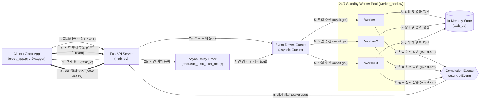
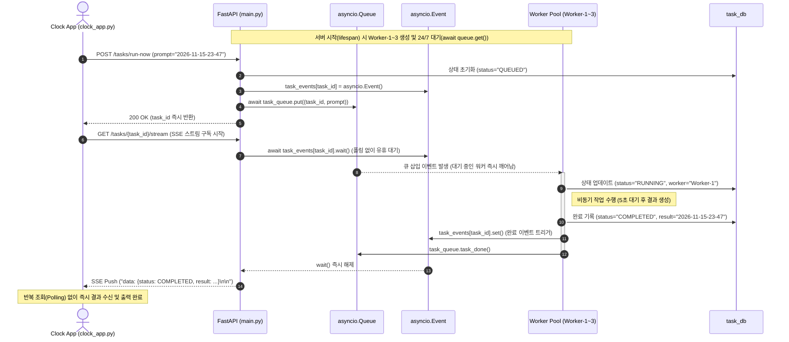

# System Architecture — async-standby-scheduler

본 문서는 **`async-standby-scheduler`**의 **완전 무폴링(Zero-Polling) 이벤트 드리븐 워커 풀 및 SSE 푸시(Push) 아키텍처**의 구조와 동작 흐름을 정의합니다.

---

## 1. 아키텍처 개요

외부 메시지 브로커(Redis 등) 없이 Python `asyncio` 이벤트 루프 위에서 **API 서버(`main.py`)**, **비동기 워커 풀(`worker_pool.py`)**, **주기적 클라이언트 앱(`clock_app.py`)**이 폴링(Polling) 없이 이벤트 기반으로 통신하는 구조입니다.

### 핵심 설계 원칙
- **완전 무폴링 (End-to-End Zero-Polling)**:
  - **서버 내부**: 워커가 `await task_queue.get()`에서 유휴 대기하다가 메시지 삽입(`put`) 이벤트가 발생하는 즉시 깨어납니다.
  - **클라이언트-서버 간**: 클라이언트가 `GET`을 반복 호출하지 않고 `SSE(Server-Sent Events)` 스트림을 열어 `await task_events[task_id].wait()`로 대기하다가, 워커 완료 즉시 결과를 푸시(Push)받습니다.
- **워커 풀 기반 동시성 제어 (Bounded Concurrency)**: `WORKER_POOL_SIZE`만큼 미리 생성된 워커 코루틴이 작업을 순차적으로 소비하므로, 동시 요청이 폭주해도 시스템 리소스를 안전하게 통제합니다.
- **모듈 간 관심사 분리 (Separation of Concerns)**: HTTP/SSE 라우팅(`main.py`), 큐/이벤트/워커 풀 관리(`worker_pool.py`), 주기적 스케줄 클라이언트(`clock_app.py`)를 명확히 분리했습니다.

---

## 2. 아키텍처 다이어그램

### ① 컴포넌트 구성도 (Component Architecture)

### ② 무폴링 SSE 푸시 작업 처리 흐름 (Sequence Diagram)

---

## 3. 모듈별 상세 역할

| 모듈 / 컴포넌트 | 파일 | 주요 역할 |
| :--- | :--- | :--- |
| **API Gateway & SSE Broker** | `main.py` | - `/tasks/run-now`, `/tasks/schedule`, `/tasks/{task_id}`, `/health` 엔드포인트 제공 - `/tasks/{task_id}/stream` SSE 스트림(`StreamingResponse`)을 통해 폴링 없이 완료 결과 푸시 - 서버 시작/종료 시 `lifespan`을 통해 워커 풀 시작 및 종료 제어 |
| **Queue, Event & Worker Pool** | `worker_pool.py` | - `asyncio.Queue` 기반 이벤트 드리븐 작업 대기열 운영 - 작업별 `asyncio.Event` 관리 및 워커 완료 시 `event.set()` 트리거 - 지정된 수(`WORKER_POOL_SIZE`)의 워커 코루틴 생성 및 비동기 작업 실행 |
| **Periodic Client App** | `clock_app.py` | - 2분(`120초`) 주기로 깨어나 `YYYY-MM-DD-HH-MM` 포맷의 작업 요청 전송 - SSE 스트림 엔드포인트를 구독하여 워커의 처리 결과를 실시간 수신 및 콘솔 출력 |
| **Automated Test Suite** | `test_main.py` | - `pytest` 및 `httpx`(`ASGITransport`)를 이용해 서버를 띄우지 않고 전체 기능 및 SSE 스트림 검증 (`TC-01` ~ `TC-10`) |

---

## 4. 기술 스택 (Tech Stack)

- **Language**: `Python 3.12`
- **Web Framework**: `FastAPI` (비동기 ASGI 웹 프레임워크 및 SSE 스트리밍 지원)
- **ASGI Server**: `Uvicorn`
- **Concurrency & Event Bus**: `Python asyncio` (`asyncio.Queue`, `asyncio.Event`, `asyncio.Task`)
- **HTTP Client & Testing**: `HTTPX`, `Pytest`, `pytest-asyncio`
