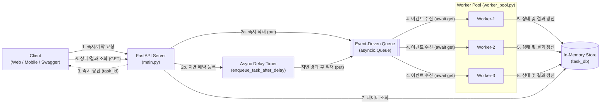
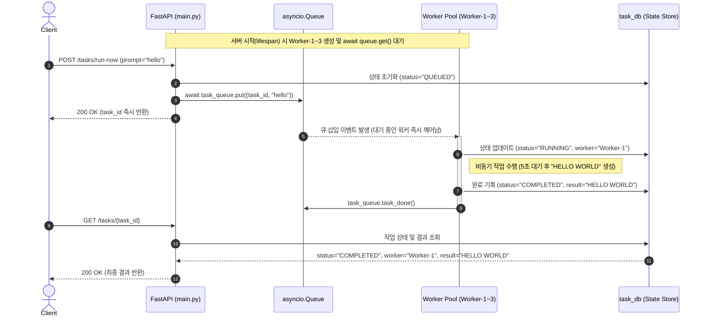

# System Architecture (Event-Driven Worker Pool)

본 문서는 외부 인프라(Redis 등) 없이 Python `asyncio` 이벤트 루프 위에서 **API 서버(`main.py`)**와 **비동기 워커 풀(`worker_pool.py`)**을 분리한 아키텍처 구조와 동작 흐름을 정의합니다.

---

## 1. 아키텍처 개요

### 핵심 설계 원칙
- **제로 폴링 & 이벤트 드리븐 (Zero-Polling & Event-Driven)**: 워커가 반복 조회(`sleep`)로 자원을 낭비하지 않고 `await task_queue.get()`에서 대기하다가, 메시지 삽입(`put`) 이벤트가 발생하는 즉시 깨어나 작업을 수행합니다.
- **워커 풀 기반 동시성 제어 (Bounded Concurrency)**: `WORKER_POOL_SIZE`만큼 미리 생성된 워커 코루틴이 작업을 순차적으로 소비하므로, 동시 요청이 폭주해도 시스템 리소스와 외부 API 호출량을 안전하게 통제할 수 있습니다.
- **모듈 간 관심사 분리 (Separation of Concerns)**: HTTP 라우팅(`main.py`)과 큐/워커 생명주기 관리(`worker_pool.py`)를 별도 모듈로 분리해, 향후 분산 메시지 브로커(Redis, RabbitMQ)로의 확장이 용이합니다.

---

## 2. 아키텍처 다이어그램

### ① 컴포넌트 구성도 (Component Architecture)

### ② 이벤트 기반 작업 처리 흐름 (Sequence Diagram)

---

## 3. 모듈별 상세 역할

| 모듈 / 컴포넌트 | 파일 | 주요 역할 |
| :--- | :--- | :--- |
| **API Gateway / Producer** | `main.py` | - `/tasks/run-now`, `/tasks/schedule`, `/tasks/{task_id}`, `/health` 엔드포인트 제공 - 서버 시작/종료 시 `lifespan`을 통해 워커 풀 시작(`start_worker_pool`) 및 종료(`stop_worker_pool`) 제어 |
| **Queue & Worker Pool** | `worker_pool.py` | - `asyncio.Queue` 기반 이벤트 드리븐 메시지 큐 운영 - 지정된 수(`WORKER_POOL_SIZE`)의 워커 코루틴 생성 및 비동기 작업 실행 - 지연 실행 타이머(`enqueue_task_after_delay`) 및 상태 저장소(`task_db`) 관리 |

---

## 4. 기술 스택 (Tech Stack)

- **Language**: `Python 3.12`
- **Web Framework**: `FastAPI` (비동기 ASGI 웹 프레임워크)
- **ASGI Server**: `Uvicorn`
- **Concurrency & Queue**: `Python asyncio` (`asyncio.Queue`, `asyncio.Task`)
