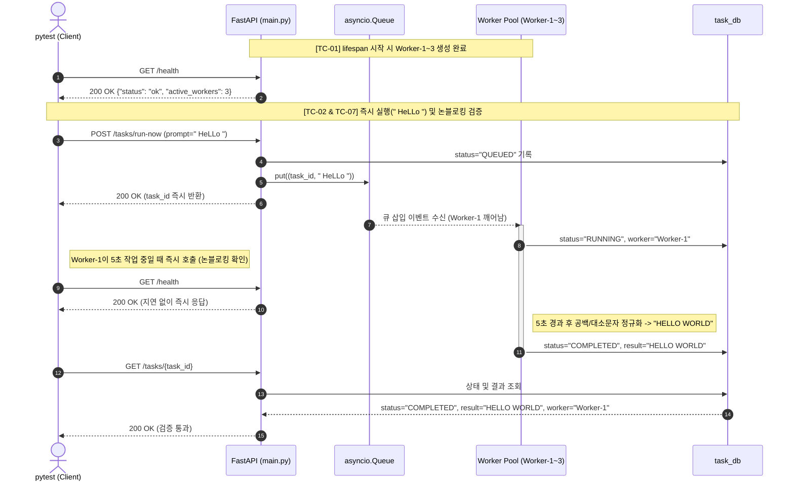
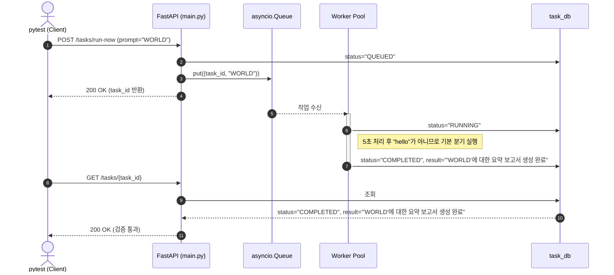
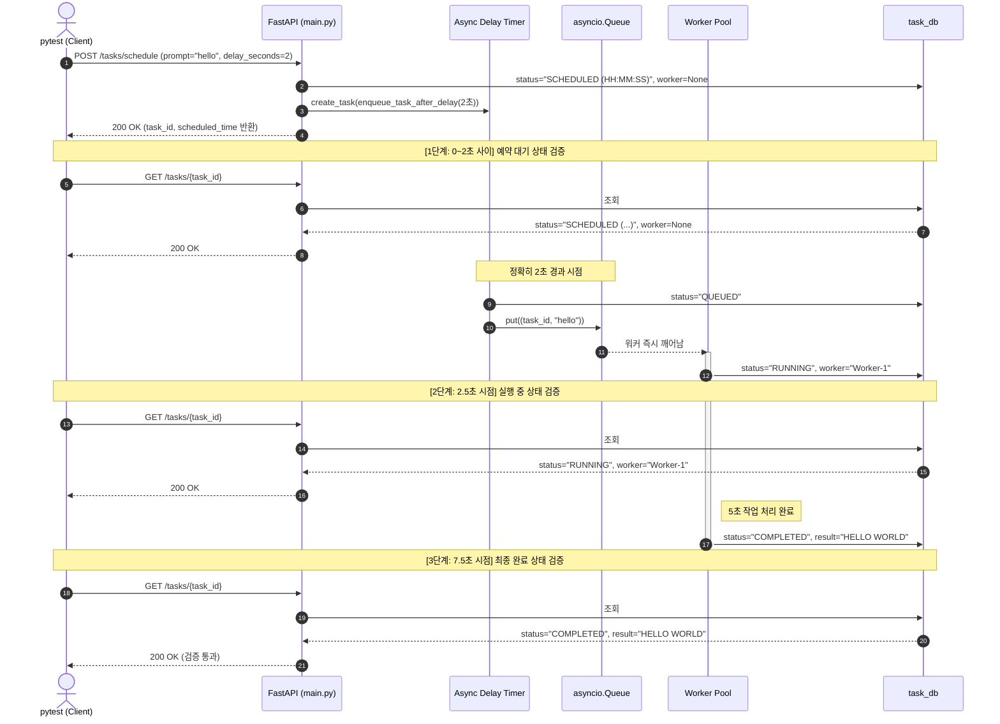
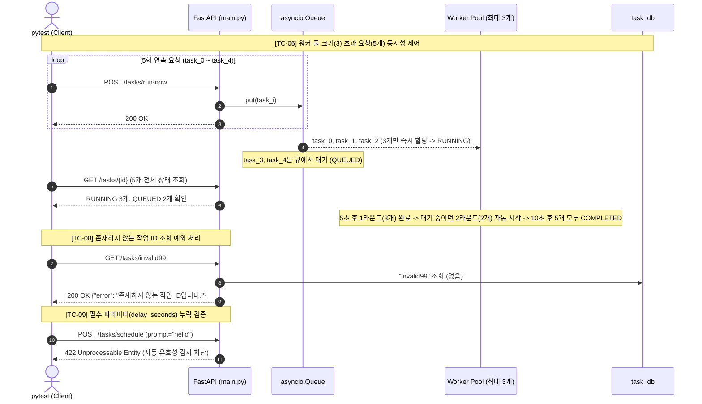

# Test Cases — async-standby-scheduler

본 문서는 **`async-standby-scheduler`**의 이벤트 기반 메시지 큐(`asyncio.Queue`), 워커 풀(`Worker Pool`), 지연 스케줄링 및 API 엔드포인트의 정상 동작을 검증하기 위한 통합 테스트 케이스 명세서입니다.

---

## 1. 테스트 환경 및 사전 조건

- **실행 환경**: Python 3.12 / FastAPI / Uvicorn (`http://127.0.0.1:8000`)
- **워커 풀 설정**: `WORKER_POOL_SIZE = 3` (`Worker-1`, `Worker-2`, `Worker-3`)
- **자동화 도구**: `pytest` + `pytest-asyncio` + `httpx` (`ASGITransport`)
- **실행 명령어**: `.\clean_test.ps1` 또는 `pytest -v`

---

## 2. 테스트 케이스 요약 표

| TC ID | 테스트 항목 | API 엔드포인트 | 입력 데이터 (Parameters) | 기대 결과 (Expected Result) | 매핑 테스트 함수 (`test_main.py`) |
| :--- | :--- | :--- | :--- | :--- | :--- |
| **TC-01** | 서버 헬스체크 및 워커 풀 가동 확인 | `GET /health` | 없음 | HTTP `200 OK` `{"status": "ok", "active_workers": 3}` | `test_tc01_health_check` |
| **TC-02** | 즉시 실행 및 `"hello"` 조건 분기 | `POST /tasks/run-now` | `prompt="  HeLLo  "` | 즉시 `task_id` 반환 후 5초 뒤 `"HELLO WORLD"` 출력 및 저장 | `test_tc02_and_tc07_run_now_hello_and_nonblocking` |
| **TC-03** | 즉시 실행 및 일반 프롬프트 기본 분기 | `POST /tasks/run-now` | `prompt="WORLD"` | 5초 후 `result`에 `'WORLD'에 대한 요약 보고서 생성 완료` 저장 | `test_tc03_run_now_default_prompt` |
| **TC-04** | 지연 스케줄링(예약 실행) 동작 확인 | `POST /tasks/schedule` | `prompt="hello"` `delay_seconds=2` | `200 OK` 및 예약 시각 반환, 정확히 2초 경과 후 큐 적재 및 실행 | `test_tc04_and_tc05_schedule_lifecycle` |
| **TC-05** | 작업 진행 단계별 상태 전이 조회 | `GET /tasks/{task_id}` | 유효한 `task_id` | `SCHEDULED` → `RUNNING` (워커 할당) → `COMPLETED` 순차 전이 | `test_tc04_and_tc05_schedule_lifecycle` |
| **TC-06** | 워커 풀 동시성 제어 | `POST /tasks/run-now` (연속 5회 호출) | `prompt="task_0"` ~ `"task_4"` | 최대 3개만 동시 `RUNNING`, 나머지 2개는 `QUEUED` 대기 후 순차 완료 | `test_tc06_worker_pool_concurrency` |
| **TC-07** | 논블로킹(Non-blocking) API 응답성 | `POST /tasks/run-now` 후 즉시 `GET /health` | `prompt="  HeLLo  "` | 백그라운드 작업 수행 중에도 `/health`가 지연 없이 즉시 `200 OK` 응답 | `test_tc02_and_tc07_run_now_hello_and_nonblocking` |
| **TC-08** | 존재하지 않는 작업 ID 조회 예외 처리 | `GET /tasks/{task_id}` | `task_id="invalid99"` | HTTP `200 OK` 및 `{"error": "존재하지 않는 작업 ID입니다."}` 반환 | `test_tc08_and_tc09_edge_cases` |
| **TC-09** | 필수 파라미터 누락 유효성 검사 | `POST /tasks/schedule` | `prompt="hello"` (`delay_seconds` 누락) | HTTP `422 Unprocessable Entity` 반환 | `test_tc08_and_tc09_edge_cases` |

---

## 3. 테스트 케이스별 상세 명세

### ① 서버 초기화 및 기본 기능 검증 (`TC-01` ~ `TC-03`)

- **TC-01: 서버 헬스체크 및 워커 풀 가동 확인 (`GET /health`)**
  - **검증 목적**: FastAPI 서버가 시작될 때 `lifespan` 이벤트가 정상 작동하여 백그라운드 워커 풀(`WORKER_POOL_SIZE = 3`)을 성공적으로 생성했는지 확인합니다.
  - **동작 및 기대 결과**: `/health` 엔드포인트로 GET 요청을 보내면 HTTP `200 OK`와 함께 `{"status": "ok", "active_workers": 3}` JSON 응답을 반환해야 합니다.

- **TC-02: 즉시 실행 및 `"hello"` 조건 분기 (`POST /tasks/run-now`)**
  - **검증 목적**: 입력값의 앞뒤 공백과 대소문자 구분 없이(`"  HeLLo  "`) 정확히 `"hello"` 명령어를 인식해 분기 처리하는지 확인합니다.
  - **동작 및 기대 결과**: 요청 즉시 `task_id`를 발급받고, 유휴 대기 중이던 워커(`Worker-1`~`3` 중 하나)가 5초간 비동기 작업 후 `"HELLO WORLD"`를 출력 및 결과(`result`)로 저장합니다.

- **TC-03: 즉시 실행 및 일반 프롬프트 기본 분기 (`POST /tasks/run-now`)**
  - **검증 목적**: `"hello"` 이외의 일반 텍스트(예: `"WORLD"`)가 입력되었을 때 예외나 오류 없이 기본 요약 보고서 분기로 처리되는지 확인합니다.
  - **동작 및 기대 결과**: 5초 뒤 작업 상태가 `COMPLETED`로 바뀌며, `result` 항목에 `"'WORLD'에 대한 요약 보고서 생성 완료"` 문구가 기록됩니다.

---

### ② 지연 스케줄링 및 상태 전이 검증 (`TC-04` ~ `TC-05`)

- **TC-04: 지연 스케줄링(예약 실행) 동작 확인 (`POST /tasks/schedule`)**
  - **검증 목적**: 지정된 지연 시간(`delay_seconds=2`)이 지나기 전에는 워커가 작업을 가져가지 않고, 정확히 2초가 경과한 시점에 이벤트 큐(`asyncio.Queue`)로 전달되는지 검증합니다.
  - **동작 및 기대 결과**: API 호출 시 `200 OK`와 함께 예약 예정 시각(`scheduled_time`)을 즉시 반환하며, 비동기 타이머가 2초 뒤 큐에 작업을 삽입합니다.

- **TC-05: 작업 진행 단계별 상태 전이 조회 (`GET /tasks/{task_id}`)**
  - **검증 목적**: 하나의 작업이 생성부터 완료까지 거치는 전체 라이프사이클(상태 변화와 워커 할당)이 실시간으로 정확히 추적되는지 확인합니다.
  - **단계별 기대 결과**:
    1. **예약 직후 (`0~2초`)**: `status`가 `"SCHEDULED (HH:MM:SS)"`이고 아직 담당 워커가 배정되지 않아 `worker`는 `None`입니다.
    2. **실행 중 (`2~7초`)**: 지연 시간이 끝나고 워커가 큐에서 작업을 꺼내면 `status`가 `"RUNNING"`으로 바뀌고 `worker`에 `"Worker-1"` 등 담당 워커 이름이 기록됩니다.
    3. **완료 후 (`7초 이후`)**: 5초간 작업 처리가 끝나면 `status`가 `"COMPLETED"`로 변경되고 `result`에 최종 결과물이 담깁니다.

---

### ③ 아키텍처 핵심 성능 및 동시성 제어 검증 (`TC-06` ~ `TC-07`)

- **TC-06: 워커 풀 동시성 제어 (`Bounded Concurrency`)**
  - **검증 목적**: 워커 풀 크기(`WORKER_POOL_SIZE = 3`)를 초과하는 요청이 한꺼번에 쏟아질 때, 시스템 과부하 없이 동시 실행 개수를 3개로 제한하고 나머지는 큐에서 안전하게 대기시키는지 검증합니다.
  - **동작 및 기대 결과**: 1초 이내에 5개의 작업을 연속 등록하면 **처음 3개는 즉시 `RUNNING`** 상태가 되고, **나머지 2개는 `QUEUED` 상태로 대기**합니다. 5초 뒤 앞선 3개 작업이 끝나면 대기하던 2개 작업이 빈 워커에 할당되어 10.5초 이내에 5개 모두 `COMPLETED`가 됩니다.

- **TC-07: 논블로킹(Non-blocking) API 응답성**
  - **검증 목적**: 워커가 무거운 작업(5초 대기)을 수행하는 도중에도 메인 이벤트 루프가 멈추지(Blocking) 않고 다른 사용자의 HTTP 요청을 즉시 처리할 수 있는지 확인합니다.
  - **동작 및 기대 결과**: `POST /tasks/run-now`로 작업을 시작한 직후(작업이 끝나기 전) `GET /health`를 호출했을 때 5초를 기다리지 않고 즉각 `200 OK`를 응답해야 합니다.

---

### ④ 예외 상황 및 입력 유효성 검증 (`TC-08` ~ `TC-09`)

- **TC-08: 존재하지 않는 작업 ID 조회 예외 처리 (`GET /tasks/{task_id}`)**
  - **검증 목적**: 클라이언트가 잘못되었거나 만료된 `task_id`(예: `"invalid99"`)로 조회하더라도 서버 내부 오류(`500 Internal Server Error`)로 뻗지 않고 안전한 안내 메시지를 반환하는지 확인합니다.
  - **동작 및 기대 결과**: HTTP `200 OK`와 함께 `{"error": "존재하지 않는 작업 ID입니다."}` JSON 객체를 반환합니다.

- **TC-09: 필수 파라미터 누락 유효성 검사 (`POST /tasks/schedule`)**
  - **검증 목적**: 스케줄링 요청 시 필수 파라미터인 `delay_seconds`를 누락했을 때 FastAPI의 입력 스키마 검증이 정상 동작하는지 확인합니다.
  - **동작 및 기대 결과**: HTTP `422 Unprocessable Entity` 상태 코드를 반환합니다.

---

## 4. 테스트 케이스별 시퀀스 다이어그램 (Sequence Diagrams)

### ① TC-01 & TC-02 & TC-07: 헬스체크, `"hello"` 조건 분기 및 논블로킹 응답성

### ② TC-03: 일반 프롬프트(`WORLD`) 기본 요약 분기

### ③ TC-04 & TC-05: 지연 스케줄링 및 단계별 상태 전이(`SCHEDULED` → `RUNNING` → `COMPLETED`)

### ④ TC-06 & TC-08 & TC-09: 워커 풀 동시성 제어 및 예외/유효성 검증

